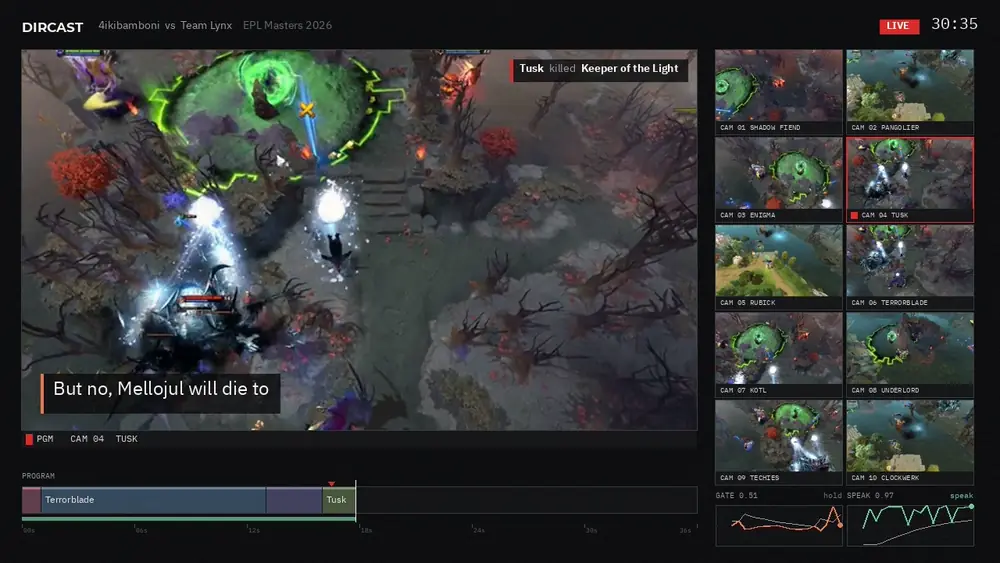
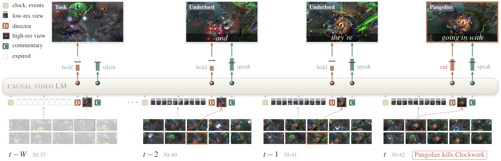

<div align="center">

# DirCast

**Live Esports Directing and Commentary with a Single Streaming Video-Language Model**

Zixian Gao<sup>1,2</sup>, Lixin Xiu<sup>2</sup>, Penghao Luo<sup>3</sup>, Erwin Wu<sup>4</sup>, Kaipeng Zhang<sup>1†</sup>

<sup>1</sup>Alaya Lab &nbsp; <sup>2</sup>The University of Tokyo &nbsp; <sup>3</sup>Georgia Institute of Technology &nbsp; <sup>4</sup>Institute of Science Tokyo

[Project page](https://zixiangao.github.io/DirCast/) · Paper (coming soon) · [Demo video](assets/dircast_demo.mp4)



<sub>DirCast on a held-out match. Pangolier kills Clockwerk away from the shot on air; DirCast cuts to the fight in the same second and comments on it. <a href="assets/dircast_demo.mp4">Full demo (86 s)</a>.</sub>

</div>

## Overview

A live esports broadcast needs a director who picks which camera goes on air and a caster who talks over that choice, every second and without knowing what comes next. DirCast is a single streaming video-language model (Qwen3-VL-8B + LoRA) that receives the raw camera of every player and does both:

- **Hold or switch.** Every second it reads the ten hero cameras at low resolution, each with a game-state token, and a director head decides whether to keep the current shot or cut, and where.
- **Comment on its own program.** The chosen camera is read again at high resolution, and the model decides whether to speak and generates the words.
- **The program is the memory.** Low-resolution views leave the context after `W` seconds; the on-air views, events and words stay, so the cost per second stays bounded.
- **Training and decoding.** Perturbed program rollouts teach recovery from the model's own wrong shots, event-anchored targets teach that kills are worth showing, and rate-controlled thresholds keep a human rhythm of cuts and speech.

<p align="center"></p>

## Code

```
dircast/
  model.py          the model: token stream, hold-or-switch director head, speak head, LoRA on Qwen3-VL
  data.py           clip dataset (ten feeds, labels, masks, commentary, game state, events)
  events.py         per-second game events and kill features from the replay metadata
  game_state.py     per-hero state features (health, damage, nearby enemies, ...)
  match_context.py  teams, heroes and players of a match (prompt context)
  train.py          training (DDP)
  tune.py           base decision thresholds, calibrated on the validation split
  stream.py         causal streaming inference with KV-cache eviction (program memory) and rate control
  evaluate.py       free-running decode of a split -> predictions + Proact-VL prediction files
  metrics.py        directing metrics, Proact-VL label files
  director_eval*.py directing evaluation (Top-1, Any-visible, cuts, kill / fight coverage) and rule baselines
  long_stream.py    long continuous streams: cost per second and cache size
scripts/
  train.sh          paper recipe
  eval.sh           test-split evaluation (directing + commentary)
  eval_commentary.sh  Proact-VL commentary metrics
```

### Setup

```bash
pip install -r requirements.txt
```

The base model is `Qwen/Qwen3-VL-8B-Instruct` (set `DIRCAST_BASE_MODEL` to use a local copy).

### Data

The dataset (27 professional Dota 2 matches with ten rendered hero cameras, the human director's choice for every second and the casters' commentary) is not included in this repository. The code expects it under `DIRCAST_DATA` (default `./data`):

```
data/
  index/{train,val,test}.jsonl     one row per 36 s clip (stride 18 s)
  index_polished/                  same index with polished commentary (used for training and evaluation)
  matches/<match_id>/t<tick>/      one 300 s window: package/*.npz (ten feeds at 1 fps), aligned/hero_k.mp4,
                                   labels/, state_feats.npy
  meta/                            match metadata (heroes, players, kills) and alignment
```

Each clip row holds per-second lists of length 36, among them `camera_labels` (the feed the human director put on air), `visible_slots` (all feeds showing an on-screen hero), `vod_state_labels` (only `LIVE` seconds are directing decisions), `verified_mask` (seconds used for training), `strict_mask` (seconds used for evaluation) and `commentary_by_second`.

### Training

```bash
export DIRCAST_INDEX=$DIRCAST_DATA/index_polished
bash scripts/train.sh runs/dircast 0 4          # out_dir, seed, number of GPUs
```

This trains for three epochs with LoRA (r = 64) and then calibrates the base cut and speak thresholds on the validation split (`runs/dircast/thresholds.json`).

### Evaluation

```bash
export PROACTVL_EVAL=/path/to/Proact-VL/evaluation/gaming   # official scripts
SKIP_JUDGE=1 bash scripts/eval.sh runs/dircast/ckpt_ep2.pt outputs/dircast 4
```

`eval.sh` streams every test clip from its first to its last second with the model's own decisions only, then reports the directing metrics and the commentary F1 and TimeDiff. For CC (win rate against GPT-4o, judged by an LLM), drop `SKIP_JUDGE=1` and set `CAPTIONS`, `OPENAI_API_KEY`, `OPENAI_BASE_URL` and `JUDGE_MODEL` (we used `gpt-5`); this calls a paid API.

### Long streams

```bash
python -m dircast.long_stream --ckpt runs/dircast/ckpt_ep2.pt --out outputs/long --horizon 36
```

## Citation

```bibtex
@article{gao2026dircast,
  title   = {DirCast: Live Esports Directing and Commentary with a Single Streaming Video-Language Model},
  author  = {Gao, Zixian and Xiu, Lixin and Luo, Penghao and Wu, Erwin and Zhang, Kaipeng},
  journal = {arXiv preprint},
  year    = {2026}
}
```
